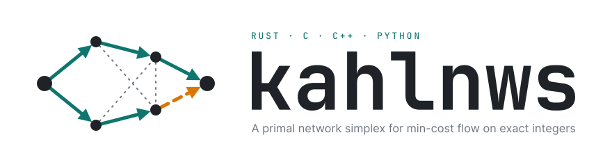

<h1 align="center">
  
</h1>

kahlnws is a primal network simplex for the min-cost flow problem on exact integers. A problem is a set of nodes,
each with a supply, and arcs between them, each with a lower bound, a capacity and a cost per unit of flow; a solve
finds a flow of least cost that meets every supply within the bounds, or answers that no such flow exists. Two types,
one contract each:

- **The solver**, `NetworkSimplex`, is a function: a problem in, an answer out. It keeps its room and nothing else.
- **A network**, `Network`, is a state: it holds one problem and a basis of it. It is changed a few numbers at a time
  or loaded with new numbers on the same arcs, solved from the basis it holds, read and copied.

What both guarantee:

- **Exact.** Every number is an integer and every sum a solve forms is exact; the cost is an `i128`.
- **Certified.** An optimal answer comes with the potentials that prove it optimal.
- **No allocation within reserved room.** Once the room is reserved, a solve into the caller's buffers allocates
  nothing, nor does a network's load, change or solve.
- **Work that follows the change.** A network's change costs what it reaches, and a load on the same arcs often takes
  far fewer pivots, to the outcome and the cost the solver answers.

## Example

A depot (node 0) sends 4 units to a customer (node 2), directly or through a hub (node 1):

```rust
use kahlnws::{Answer, NetworkSimplex, Outcome, Problem, ProblemError};

fn main() -> Result<(), ProblemError> {
    let problem = Problem {
        tails: &[0, 0, 1],
        heads: &[2, 1, 2],
        lower_bounds: None,
        capacities: &[3, 4, 2],
        costs: &[5, 1, 1],
        supplies: &[4, 0, -4],
    };

    let mut solver = NetworkSimplex::new();
    let Answer { outcome, work } = solver.solve(&problem)?;
    match outcome {
        Outcome::Optimal(solution) => {
            assert_eq!(solution.flows, [2, 2, 2]);
            assert_eq!(solution.total_cost, 14);
        }
        Outcome::Infeasible => unreachable!("the depot's arcs carry the customer's demand"),
    }
    println!("{} pivots, {} of them degenerate", work.pivots, work.degenerate_pivots);

    Ok(())
}
```

## Documentation

- [The Rust guide][rust-api]: the tasks of the interface, one by one.
- [The problem and the guarantees][problem-and-guarantees]: the linear program, the certificate, the
  ranges and the refusals.
- [How it works][how-it-works]: the algorithm and the layout of its data.
- [Benchmarks][benchmarks]: the three suites, and a comparison with two LP solvers.
- [The examples][examples]: six programs on one small transport network.

The solver and a network are offered to C, C++ and Python from [the repository](https://github.com/FelixKahle/kahlnws).

## Licence

Licensed under either of the Apache License, Version 2.0 or the MIT License, at your option.

[rust-api]: https://github.com/FelixKahle/kahlnws/blob/main/docs/rust-api.md
[problem-and-guarantees]: https://github.com/FelixKahle/kahlnws/blob/main/docs/problem-and-guarantees.md
[how-it-works]: https://github.com/FelixKahle/kahlnws/blob/main/docs/how-it-works.md
[benchmarks]: https://github.com/FelixKahle/kahlnws/blob/main/docs/benchmarks.md
[examples]: https://github.com/FelixKahle/kahlnws/blob/main/crates/kahlnws/examples
