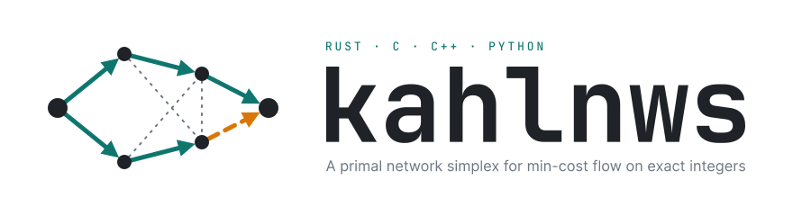

<h1 align="center">
  
</h1>

kahlnws is a primal network simplex for the min-cost flow problem on exact integers, written in Rust, as a Python
package. A problem is a set of nodes, each with a supply, and arcs between them, each with a lower bound, a capacity
and a cost per unit of flow; a solve finds a flow of least cost that meets every supply within the bounds, or answers
that no such flow exists.

- **Exact.** Every number is an integer and every sum a solve forms is exact; the cost is a Python `int`.
- **Certified.** An optimal answer comes with the potentials that prove it optimal.
- **No dependency, fully typed.** One wheel serves CPython 3.11 and later. Columns are sequences of `int` or buffers
  such as NumPy arrays; NumPy itself is never needed.

## Installing

```sh
pip install kahlnws
```

## Example

A depot (node 0) sends 4 units to a customer (node 2), directly or through a hub (node 1):

```python
import kahlnws

solver = kahlnws.NetworkSimplex()
answer = solver.solve(tails=[0, 0, 1], heads=[2, 1, 2], capacities=[3, 4, 2], costs=[5, 1, 1], supplies=[4, 0, -4])
assert answer.outcome is not None
assert answer.outcome.flows == [2, 2, 2] and answer.outcome.total_cost == 14
```

A caller who solves in a loop keeps one solver and has the flows written into a buffer of its own with `solve_into`.
Where only the numbers change, on the same arcs, `resolve` and `resolve_into` start from the basis the last solve ended
on and often make far fewer pivots; where that basis cannot serve, they answer exactly what a solve answers.

## Documentation

- [The Python guide][python-api]: installing, buffers, NumPy and the exceptions.
- [The problem and the guarantees][problem-and-guarantees]: the linear program, the certificate, the
  ranges and the refusals.
- [Benchmarks][benchmarks]: the suite, and a comparison with two LP solvers.
- [The examples][examples]: five scripts on one small transport network.

The same solver is offered to Rust, C and C++ from [the repository](https://github.com/FelixKahle/kahlnws).

## Licence

Licensed under either of the Apache License, Version 2.0 or the MIT License, at your option.

[python-api]: https://github.com/FelixKahle/kahlnws/blob/main/docs/python-api.md
[problem-and-guarantees]: https://github.com/FelixKahle/kahlnws/blob/main/docs/problem-and-guarantees.md
[benchmarks]: https://github.com/FelixKahle/kahlnws/blob/main/docs/benchmarks.md
[examples]: https://github.com/FelixKahle/kahlnws/blob/main/crates/kahlnws_python/examples
